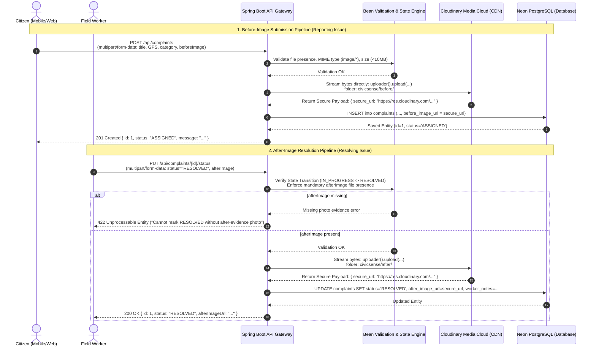

# CivicSense — Image Storage & Evidence Pipeline Architecture

This document describes the end-to-end architecture, lifecycle, and data flow of **Image Storage** within the CivicSense platform.

---

## 1. Executive Summary

Civic complaints require photographic proof at two critical stages of their lifecycle:
1. **"Before" Photo Evidence** — Submitted by the Citizen when reporting an issue. Proves the existence, severity, and context of the civic problem.
2. **"After" Photo Evidence** — Submitted by the Municipal Field Worker when marking an issue `RESOLVED`. Proves that the repair was satisfactorily executed before the ticket can progress.

The image storage pipeline uses **Cloudinary** (via the official Java SDK `cloudinary-http5:2.5.0`) to handle media asset ingestion, transformation, secure HTTPS storage, and global CDN delivery. The Spring Boot backend acts as a secure processing gateway, ensuring validation and transaction atomicity while saving permanent URLs in **PostgreSQL**.

---

## 2. High-Level Architecture Diagram



---

## 3. Directory & Namespace Structure in Cloudinary

All images uploaded through the system are partitioned into distinct namespaces configured under the root `${CLOUDINARY_FOLDER}` (default `civicsense`):

```
civicsense/
├── before/           <-- Citizen-uploaded initial evidence
│   ├── pothole_main_st_a1b2c3d4.jpg
│   ├── garbage_pile_e5f6g7h8.png
│   └── broken_light_j9k0l1m2.webp
└── after/            <-- Worker-uploaded resolution evidence
    ├── pothole_main_st_fixed_n3o4p5q6.jpg
    └── broken_light_repaired_r7s8t9u0.jpg
```

### Key Properties Configured:
- **`unique_filename: true`** — Prevents filename collision if two citizens upload images named `photo.jpg`.
- **`use_filename: true`** — Retains human-readable original filenames for administrative tracking.
- **`resource_type: "image"`** — Enforces strict image classification and processing.
- **`secure: true`** — Guarantees all generated URLs use `https://`.

---

## 4. End-to-End Image Flows

### 4.1 Flow 1: Reporting an Issue ("Before" Image)

1. **Client Submission:**
   - The user fills in description, GPS coordinates, category, and attaches an image file.
   - Form is posted to `POST /api/complaints` as `multipart/form-data`.
2. **Spring Boot Validation & Controller Layer:**
   - Handled by `ComplaintController.createComplaint(@ModelAttribute @Valid CreateComplaintForm form)`.
   - Bean validation enforces:
     - `@NotNull MultipartFile beforeImage`
     - Valid GPS bounds (`-90 <= latitude <= 90`, `-180 <= longitude <= 180`)
     - Maximum file size constrained to `10MB` via Spring configuration.
3. **Cloudinary Streaming Service (`CloudinaryStorageService`):**
   - The service receives the `MultipartFile`.
   - Calls `cloudinary.uploader().upload(file.getBytes(), ObjectUtils.asMap("folder", "civicsense/before", ...))`.
   - The file bytes are streamed over HTTPS directly to Cloudinary's ingress edge servers.
   - Cloudinary returns the secure HTTPS URL (e.g., `https://res.cloudinary.com/<cloud>/image/upload/v1234/civicsense/before/<name>.jpg`).
4. **Database Persistence:**
   - The complaint is created with `before_image_url = secureUrl`.
   - Spatial deduplication runs to link to parent complaints if nearby.
   - Complaint is saved to Neon PostgreSQL.

---

### 4.2 Flow 2: Resolving an Issue ("After" Image Gate)

1. **Worker Submission:**
   - Field worker performs the physical repair on site (e.g. fills pothole, clears dumpster, replaces streetlight).
   - Worker captures a photo of the completed repair.
   - Submits `PUT /api/complaints/{id}/status` with `status=RESOLVED`, `afterImage=<file>`, and optional `workerNotes`.
2. **State Machine & Evidence Validation Gate:**
   - Handled in `ComplaintServiceImpl.updateStatus(...)`.
   - State transition check: Ensures transition is valid (e.g. `IN_PROGRESS` &rarr; `RESOLVED`).
   - **Evidence Gate Enforcement:**
     ```java
     if (target == ComplaintStatus.RESOLVED) {
         if (form.getAfterImage() != null && !form.getAfterImage().isEmpty()) {
             String afterUrl = storageService.store(form.getAfterImage(), "after");
             complaint.setAfterImageUrl(afterUrl);
         } else if (!StringUtils.hasText(complaint.getAfterImageUrl())) {
             throw new IllegalStateTransitionException(
                 "Cannot mark complaint RESOLVED without an after-evidence photo.");
         }
     }
     ```
   - If no after-image is provided, the API rejects the request with **HTTP 422 Unprocessable Entity**.
3. **Storage & Audit Record:**
   - The photo is uploaded to Cloudinary folder `civicsense/after/`.
   - The complaint record in PostgreSQL is updated with:
     - `status = 'RESOLVED'`
     - `after_image_url = <cloudinary_https_url>`
     - `worker_notes = <repair_notes>`
     - `updated_at = NOW()`

---

## 5. Storage Abstraction & Code Architecture

The platform follows a clean **Strategy / Interface-driven** design:

```
src/main/java/com/example/civicsense/
├── config/
│   └── CloudinaryConfig.java             <-- Initializes Cloudinary bean with credentials
├── storage/
│   ├── StorageService.java               <-- Storage interface abstraction
│   └── CloudinaryStorageService.java     <-- Cloudinary SDK implementation
├── dto/
│   ├── request/
│   │   ├── CreateComplaintForm.java      <-- Multipart model for issue reporting
│   │   └── UpdateComplaintStatusForm.java<-- Multipart model for worker triage
│   └── response/
│       ├── ComplaintDetailResponse.java  <-- Contains beforeImageUrl & afterImageUrl
│       └── ComplaintSummaryResponse.java <-- Contains beforeImageUrl for feeds
```

### 1. `StorageService.java` (Interface)
```java
public interface StorageService {
    /**
     * Uploads a multipart file to cloud storage and returns the permanent HTTPS URL.
     */
    String store(MultipartFile file, String folder);
}
```

### 2. `CloudinaryConfig.java` (Configuration)
```java
@Configuration
public class CloudinaryConfig {
    @Value("${app.storage.cloudinary.cloud-name}")
    private String cloudName;
    @Value("${app.storage.cloudinary.api-key}")
    private String apiKey;
    @Value("${app.storage.cloudinary.api-secret}")
    private String apiSecret;

    @Bean
    public Cloudinary cloudinary() {
        return new Cloudinary(Map.of(
            "cloud_name", cloudName,
            "api_key",    apiKey,
            "api_secret", apiSecret,
            "secure",     true
        ));
    }
}
```

### 3. `CloudinaryStorageService.java` (Upload Implementation)
```java
@Service
@RequiredArgsConstructor
@Slf4j
public class CloudinaryStorageService implements StorageService {
    private final Cloudinary cloudinary;

    @Value("${app.storage.cloudinary.folder:civicsense}")
    private String baseFolder;

    @Override
    public String store(MultipartFile file, String folder) {
        if (file == null || file.isEmpty()) {
            throw new StorageException("Cannot store an empty file.");
        }
        String publicIdFolder = baseFolder + "/" + folder;
        try {
            Map<?, ?> result = cloudinary.uploader().upload(
                file.getBytes(),
                ObjectUtils.asMap(
                    "folder",          publicIdFolder,
                    "resource_type",   "image",
                    "use_filename",    true,
                    "unique_filename", true
                )
            );
            return (String) result.get("secure_url");
        } catch (IOException e) {
            throw new StorageException("Failed to upload image to Cloudinary: " + e.getMessage(), e);
        }
    }
}
```

---

## 6. Configuration & Environment Variables

Image storage is configured via `src/main/resources/application.yaml` and loaded strictly from `.env`:

### `application.yaml`
```yaml
spring:
  servlet:
    multipart:
      enabled: true
      max-file-size: ${MAX_FILE_SIZE}
      max-request-size: ${MAX_REQUEST_SIZE}

app:
  storage:
    cloudinary:
      cloud-name: ${CLOUDINARY_CLOUD_NAME}
      api-key: ${CLOUDINARY_API_KEY}
      api-secret: ${CLOUDINARY_API_SECRET}
      folder: ${CLOUDINARY_FOLDER}
```

### `.env`
```properties
# Cloudinary Storage Configuration
CLOUDINARY_CLOUD_NAME=your_cloudinary_cloud_name
CLOUDINARY_API_KEY=your_cloudinary_api_key
CLOUDINARY_API_SECRET=your_cloudinary_api_secret
CLOUDINARY_FOLDER=civicsense

# File Upload Constraints
MAX_FILE_SIZE=10MB
MAX_REQUEST_SIZE=15MB
```

---

## 7. Error Handling & Edge Cases

| Failure Scenario | Handled By | Response to Client |
|---|---|---|
| **File exceeds 10MB limit** | `GlobalExceptionHandler` (`MaxUploadSizeExceededException`) | `413 Payload Too Large` with user-friendly message |
| **No image attached when filing complaint** | `@NotNull` on `CreateComplaintForm.beforeImage` | `400 Bad Request` (`beforeImage photo is required`) |
| **Worker attempts `RESOLVED` without afterImage** | `ComplaintServiceImpl` evidence check | `422 Unprocessable Entity` (`Cannot mark RESOLVED without an after-evidence photo`) |
| **Cloudinary API network / auth error** | `CloudinaryStorageService` (`StorageException`) | `500 Internal Server Error` (logs internal error; never leaks API secrets to client) |

---

## 8. Summary of Benefits

1. **Direct CDN Acceleration:** Clients worldwide fetch photos directly through Cloudinary's fast Content Delivery Network without placing load on the Spring Boot backend.
2. **Database Leanliness:** PostgreSQL stores only high-efficiency `VARCHAR(2048)` URL strings rather than binary BLOBs or BYTEA, ensuring fast query performance and minimal backup footprint.
3. **Automated Evidence Auditing:** The strict code gate on the `RESOLVED` transition prevents municipal tickets from being closed without verifiable before-and-after photographic evidence.
